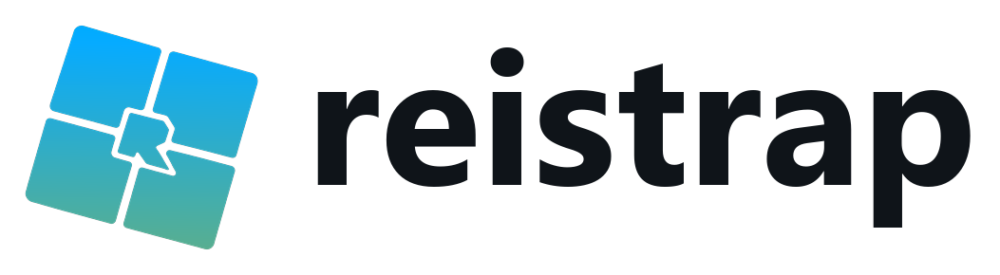
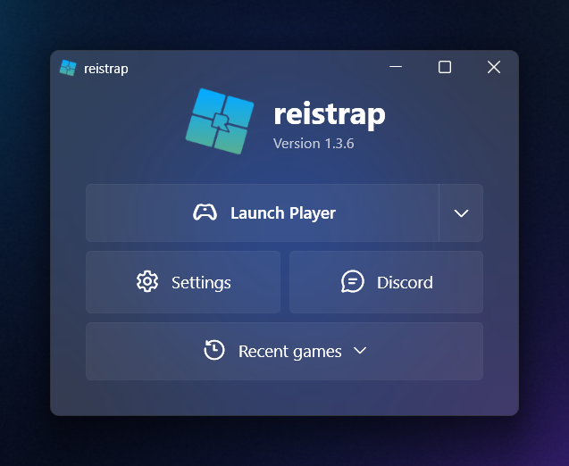
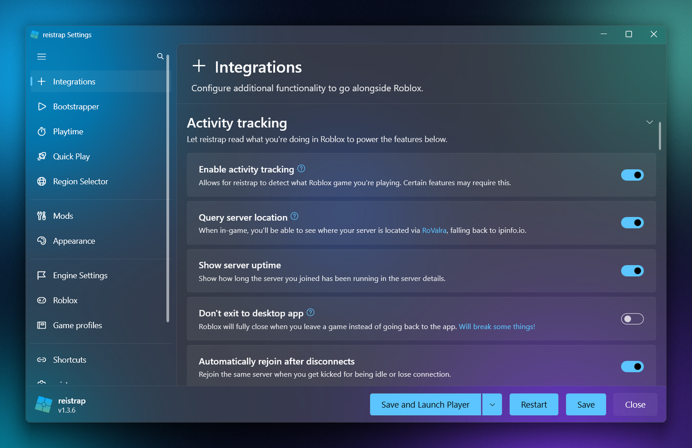
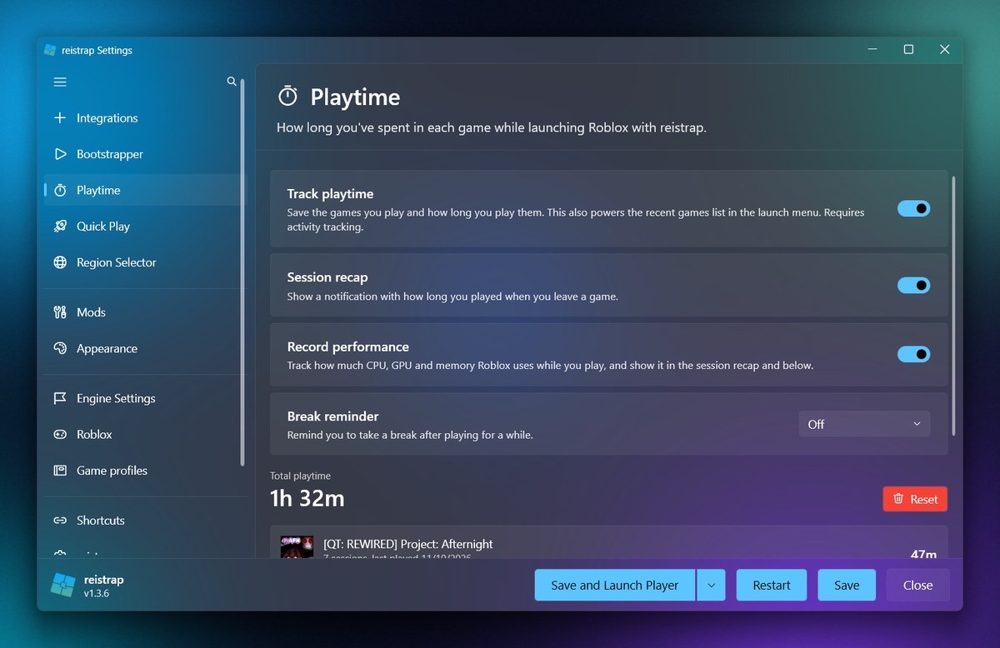
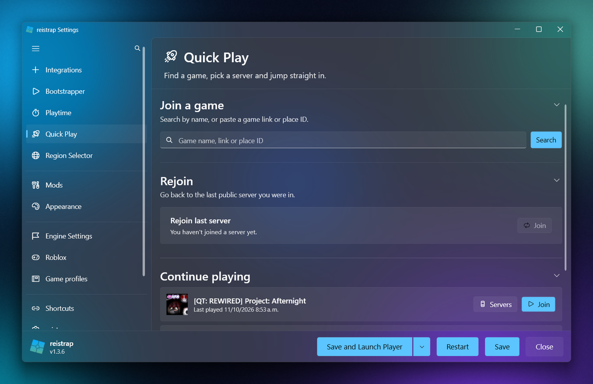
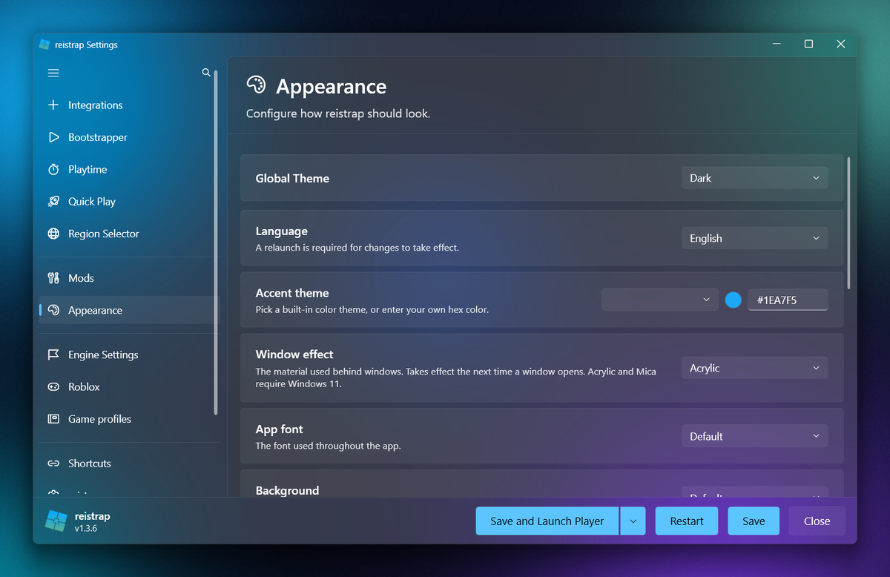

> [!IMPORTANT]
> **reistrap** is an independent, unofficial fork of the open-source project [Bloxstrap](https://github.com/bloxstraplabs/bloxstrap). It is not affiliated with, maintained by, or endorsed by the original Bloxstrap developers.

    <picture>
        <source media="(prefers-color-scheme: dark)" srcset="Images/reistrap-full-dark.png">
        
    </picture>

    A Roblox bootstrapper with more features, more customization and a cleaner look.

    
    
    
    

    <a href="https://github.com/1lyst4r/reistrap/releases/latest"><b>Download the latest release</b></a>

    

----

**reistrap** is a third-party replacement for the standard Roblox bootstrapper, providing additional useful features and improvements.

Running into a problem or need help with something? Check out the Wiki (not available). If you can't find anything, or would like to suggest something, please submit an issue.

**reistrap** is only supported for PCs running Windows.

## Highlights

### Know where you are and show what you're playing

Discord Rich Presence with the game's name and icon, join buttons and your Roblox account, plus Roblox Studio support. See where your server is located and how long it has been running, and automatically rejoin after being kicked for inactivity or losing connection.

    

### Playtime tracking

Every game you play is tracked, with total playtime, a recap when you leave a game, break reminders and a performance log of CPU, GPU and memory use for each session.

    

### Quick Play

Search for any game by name, link or place ID, browse its places and public servers and jump straight in. Rejoin your last server or continue one of your recent games in one click.

    

### Make it yours

Mica, Acrylic or Aero window effects, accent colors with a color picker, custom fonts and backgrounds that can be a solid color, a gradient with as many colors as you want, or an image. The loading window has its own styles too, including a Roblox 2025 look and fully custom themes.

    

## Features

- Hassle-free Discord Rich Presence to let your friends know what you're playing at a glance, including in Roblox Studio
- Simple support for modding of content files for customizability (death sound, mouse cursor, Shift Lock icon, etc)
- Mod generator to recolor Roblox's UI icons, cursors and the Shift Lock icon with your own gradient
- Color mods, cursor sets and mod packs you can share with friends
- See where your server is geographically located (courtesy of [RoValra](https://www.rovalra.com) and [ipinfo.io](https://ipinfo.io)) and how long it has been running
- Region selector to join servers near you, or browse a game's servers by city
- Quick Play to search games, pick a server and join from reistrap
- Ability to configure graphics fidelity and UI experience
- Edit Roblox's own settings, like raising the frame rate cap
- Game profiles to use different settings for specific games
- Run multiple Roblox instances at the same time
- Automatically rejoin your server after being kicked for inactivity
- Playtime tracking for every game, with session recaps, break reminders and a performance log
- Rejoin your recently played games right from the launch menu
- Window control for games made for Funkstrap, with a permission list for every game that uses it
- Fast Flag profiles, with a warning for flags that aren't on the Roblox allowlist
- Switch Roblox channels, block Roblox updates or keep Roblox in a fixed install folder
- Crosshair overlay, SOCD (snap tap), borderless windowed mode and custom window titles
- Cache cleaner to free up disk space
- Accent themes with a color picker, custom fonts, gradient and image backgrounds and window effects
- Import your settings from other bootstrappers, or back everything up into a single file

See [docs/FEATURES.md](docs/FEATURES.md) for the full list.

## Frequently Asked Questions

**Q: Is this safe / malware-free?**

**A:** Yes. Just like the original project, reistrap is fully open-source. Every line of code is viewable right here on GitHub. However, because this is a third-party fork, **do not** seek support from the official Bloxstrap team if you encounter bugs. Please open an issue on this repository instead.

**Q: Can using this get me banned?**

**A:** No, it shouldn't. **reistrap** doesn't interact with the Roblox client in the same way that exploits do, and never will.
[Read more about that here.](https://bloxstraplabs.com/wiki/info/bloxstrap-and-bans)

## Installing
Download the [latest release](https://github.com/1lyst4r/reistrap/releases/latest) of **reistrap**, and run it. Configure your preferences if needed, and install. That's about it!

You will also need the [.NET 6 Desktop Runtime](https://aka.ms/dotnet-core-applaunch?missing_runtime=true&arch=x64&rid=win11-x64&apphost_version=6.0.36&gui=true). If you don't already have it installed, you'll be prompted to install it anyway. Be sure to install **reistrap** after you've installed this.

It's not unlikely that Windows Smartscreen will show a popup when you run **reistrap** for the first time. This happens because it's an unknown program, not because it's actually detected as being malicious. To dismiss it, just click on "More info" and then "Run anyway".

Once installed, **reistrap** is added to your Start Menu, where you can access the menu and reconfigure your preferences if needed.

## Code

**reistrap** uses the [WPF UI](https://github.com/lepoco/wpfui) library for the user interface design.

    <picture>
        <source media="(prefers-color-scheme: dark)" srcset="Images/reistrap-full-dark.png">
        
    </picture>

